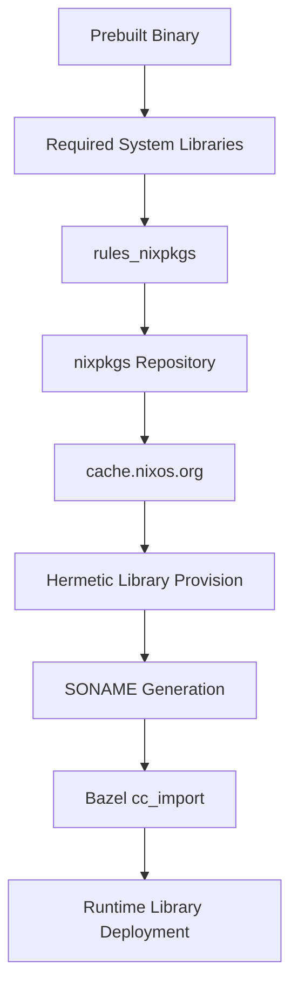

# Hermetic System Library Integration Tutorial

A comprehensive guide to integrating prebuilt binaries that depend on system libraries into Bazel using modern hermetic approaches.

## Table of Contents

1. [The Problem](#the-problem)
2. [Understanding System Dependencies](#understanding-system-dependencies)
3. [Solution Architecture](#solution-architecture)
4. [Step-by-Step Implementation](#step-by-step-implementation)
5. [Advanced Patterns](#advanced-patterns)
6. [Troubleshooting](#troubleshooting)
7. [Best Practices](#best-practices)

## The Problem

### Common Scenario: Third-Party Prebuilt Binaries

You have a prebuilt binary (library or executable) that you want to integrate into your Bazel project, but it has runtime dependencies on system libraries. Examples include:

- **Graphics libraries** (OpenGL, Vulkan drivers)
- **Threading libraries** (Intel TBB, OpenMP)
- **Runtime libraries** (libc++, libstdc++)
- **Compression libraries** (zlib, lz4, bzip2)
- **Networking libraries** (OpenSSL, curl)

### The Traditional Approach (Problems)

```bash
# Traditional approach - system package installation
sudo apt-get install libtbb-dev libgl1-mesa-dev  # Ubuntu
brew install tbb mesa                             # macOS
pacman -S intel-tbb mesa                         # Arch
```

**Issues with traditional approach:**
- ❌ **Non-hermetic builds**: Different versions across systems
- ❌ **CI/CD complexity**: Must install packages on all build machines
- ❌ **Version conflicts**: Multiple projects needing different versions
- ❌ **Reproducibility issues**: "Works on my machine" problems
- ❌ **Cross-compilation difficulties**: Host vs target library versions

### The Hermetic Solution

This tutorial teaches you to create **completely self-contained builds** where:
- ✅ **Zero host dependencies**: All libraries provided by Bazel
- ✅ **Reproducible builds**: Same versions everywhere
- ✅ **Isolated environments**: No conflicts between projects
- ✅ **Cross-platform consistency**: Works identically on all systems

## Understanding System Dependencies

### Step 1: Discover Runtime Dependencies

Before integrating any prebuilt binary, you must understand its dependencies.

#### Using `readelf` (Linux)

```bash
# Download your prebuilt binary first
readelf -d path/to/your/prebuilt.so

# Example output:
Dynamic section at offset 0x2e5d00 contains 34 entries:
  Tag        Type                         Name/Value
 0x0000000000000001 (NEEDED)             Shared library: [libtbb.so.12]
 0x0000000000000001 (NEEDED)             Shared library: [libc++.so.1]
 0x0000000000000001 (NEEDED)             Shared library: [libGL.so.1]
 0x0000000000000001 (NEEDED)             Shared library: [libc.so.6]
```

#### Using `otool` (macOS)

```bash
otool -L path/to/your/prebuilt.dylib

# Example output:
path/to/your/prebuilt.dylib:
    /usr/lib/libc++.1.dylib (compatibility version 1.0.0)
    /usr/lib/libSystem.B.dylib (compatibility version 1.0.0)
    @rpath/libtbb.dylib (compatibility version 12.0.0)
```

### Step 2: Understand SONAME vs Actual Files

**Critical concept**: The dynamic linker searches for **SONAME**, not actual filenames.

```bash
# Example: TBB library
Actual file:     libtbb.so.12.14      # What nixpkgs provides
SONAME:          libtbb.so.12         # What your binary expects
Symlink:         libtbb.so            # Development symlink
```

**Why this matters**: Your prebuilt binary expects `libtbb.so.12`, but package managers often provide `libtbb.so.12.14`. You must create the exact SONAME file hermetically.

### Step 3: Version Compatibility

Check which specific versions your binary was compiled against:

```bash
# Check specific version requirements
objdump -p your_binary | grep NEEDED
nm -D your_binary | grep TBB  # Check for specific symbol versions

# Verify library compatibility
ldd your_binary  # Shows where libraries would be loaded from
```

## Solution Architecture

### Overview: Hermetic System Library Provision

Our approach uses **rules_nixpkgs** to provide system libraries hermetically via cache.nixos.org:



### Key Components

1. **rules_nixpkgs**: Bazel rules for importing Nix packages
2. **nixpkgs repository**: Curated collection of 120,000+ packages
3. **SONAME generation**: Creating expected library names hermetically
4. **cc_import targets**: Proper Bazel integration for shared libraries
5. **Automatic deployment**: Bazel's _solib_k8 runtime library handling

## Step-by-Step Implementation

### Step 1: Setup Bazel Module Configuration

Add rules_nixpkgs to your `MODULE.bazel`:

```starlark
# MODULE.bazel

# Add rules_nixpkgs dependency
bazel_dep(name = "rules_nixpkgs_core", version = "0.13.0")

# Configure nixpkgs repository
nix_repo = use_extension("@rules_nixpkgs_core//extensions:repository.bzl", "nix_repo")
nix_repo.github(
    name = "nixpkgs",
    org = "NixOS",
    repo = "nixpkgs",
    commit = "25.05",  # Use stable nixpkgs release
    sha256 = "",       # Let Bazel compute the hash for reproducibility
)
use_repo(nix_repo, "nixpkgs")
```

### Step 2: Configure System Libraries

Add package configurations to your `MODULE.bazel`:

```starlark
# Configure system packages
nix_pkg = use_extension("@rules_nixpkgs_core//extensions:packages.bzl", "nix_pkg")

# Simple library (no SONAME issues)
nix_pkg.attr(
    name = "libgl",
    attr = "libGL",  # nixpkgs attribute path
)

# Complex library (requires SONAME generation)
nix_pkg.attr(
    name = "tbb",
    attr = "tbb_2022_0",  # Specific version for compatibility
    build_file_content = """
# SONAME generation for library compatibility
# Your binary expects libtbb.so.12 but nixpkgs provides libtbb.so.12.14
genrule(
    name = "make_tbb_soname",
    srcs = ["lib/libtbb.so.12.14"],    # Actual file from nixpkgs
    outs = ["libtbb.so.12"],           # Expected SONAME
    cmd = "cp $< $@",                  # Create SONAME hermetically
    visibility = ["//visibility:public"],
)

# cc_import with proper SONAME
cc_import(
    name = "tbb_hermetic",
    shared_library = ":make_tbb_soname",  # Reference the genrule output
    visibility = ["//visibility:public"],
)
""",
)

# Make packages available
use_repo(nix_pkg, "libgl", "tbb")
```

### Step 3: Import Your Prebuilt Binary

Create your prebuilt binary import (e.g., `my_library.BUILD`):

```starlark
# my_library.BUILD

"""
Prebuilt Library with Hermetic System Dependencies

This BUILD file defines integration of a prebuilt binary with all required
system dependencies provided hermetically via rules_nixpkgs.
"""

package(default_visibility = ["//visibility:public"])

# Import the prebuilt binary
cc_import(
    name = "prebuilt_lib",
    shared_library = select({
        "@platforms//os:linux": "lib/libmylibrary.so.1.0",
        "@platforms//os:macos": "lib/libmylibrary.dylib",
        "//conditions:default": "lib/libmylibrary.so.1.0",
    }),
    hdrs = glob(["include/**/*.h"]),
    includes = ["include"],
    deps = [
        # Include system dependencies hermetically
        "@tbb//:tbb_hermetic",
        "@libgl//:libgl",  # Add other dependencies as needed
    ],
)

# Main target with all dependencies
cc_library(
    name = "my_library",
    deps = [
        ":prebuilt_lib",
    ],
)
```

### Step 4: Declare Your Binary in MODULE.bazel

Add your prebuilt binary import:

```starlark
# MODULE.bazel

# Your prebuilt binary
http_archive(
    name = "my_library",
    urls = ["https://releases.example.com/my_library-1.0.0-linux.tar.gz"],
    strip_prefix = "my_library-1.0.0",
    build_file = "//path/to:my_library.BUILD",
    sha256 = "abc123...",  # Always include SHA for security
)
```

### Step 5: Use in Your Application

Create your application that uses the prebuilt library:

```starlark
# BUILD.bazel

cc_binary(
    name = "my_app",
    srcs = ["main.cpp"],
    deps = [
        "@my_library//:my_library",  # Your prebuilt library with hermetic deps
    ],
    # Standard runtime libraries if needed
    linkopts = [
        "-ldl",        # Dynamic loading support
        "-lpthread",   # POSIX threading
    ],
)
```

## Advanced Patterns

### Pattern 1: Multiple Related Libraries

For library ecosystems (like OpenGL stack):

```starlark
# Configure related libraries together
nix_pkg.attr(name = "mesa", attr = "mesa")
nix_pkg.attr(name = "glew", attr = "glew")
nix_pkg.attr(name = "libglvnd", attr = "libglvnd")

# Create convenience target
cc_library(
    name = "opengl_stack",
    deps = [
        "@mesa//:mesa",
        "@glew//:glew",
        "@libglvnd//:libglvnd",
    ],
    visibility = ["//visibility:public"],
)
```

### Pattern 2: Version-Specific Dependencies

When you need exact library versions:

```starlark
nix_pkg.attr(
    name = "tbb",
    attr = "tbb_2022_0",  # Not just "tbb" - specify exact version
    build_file_content = """
# Version validation in genrule
genrule(
    name = "make_tbb_soname",
    srcs = ["lib/libtbb.so.12.14"],
    outs = ["libtbb.so.12"],
    cmd = '''
    # Validate this is the expected version
    if readelf -d $< | grep -q "SONAME.*libtbb.so.12"; then
        cp $< $@
    else
        echo "ERROR: Expected TBB SONAME libtbb.so.12" >&2
        exit 1
    fi
    ''',
)
""",
)
```

### Pattern 3: Cross-Compilation Support

For building across different architectures:

```starlark
# Platform-specific configuration
nix_pkg.attr(
    name = "tbb_x86_64",
    attr = "tbb_2022_0",
    build_file_content = """
genrule(
    name = "make_tbb_soname",
    srcs = ["lib/libtbb.so.12.14"],
    outs = ["libtbb.so.12"],
    cmd = '''
    # Validate architecture matches
    if file $< | grep -q "x86-64"; then
        cp $< $@
    else
        echo "Architecture mismatch: expected x86-64" >&2
        exit 1
    fi
    ''',
)

cc_import(
    name = "tbb_hermetic",
    shared_library = ":make_tbb_soname",
    target_compatible_with = ["@platforms//cpu:x86_64"],
)
""",
)
```

### Pattern 4: Development vs Production Libraries

Different configurations for different needs:

```starlark
# Development configuration with debug symbols
nix_pkg.attr(
    name = "tbb_debug",
    attr = "tbb_2022_0.debug",
    build_file_content = """
cc_import(
    name = "tbb_hermetic_debug",
    shared_library = "lib/libtbb.so.12.14",
    # Include debug information
    tags = ["debug"],
)
""",
)

# Production optimized configuration
nix_pkg.attr(
    name = "tbb_release",
    attr = "tbb_2022_0",
    build_file_content = """
cc_import(
    name = "tbb_hermetic_release",
    shared_library = ":make_tbb_soname",
    tags = ["release"],
)
""",
)
```

## Troubleshooting

### Problem 1: Library Not Found at Runtime

**Error**: `error while loading shared libraries: libtbb.so.12: cannot open shared object file`

**Diagnosis**:
```bash
# Check if your binary can find libraries
ldd bazel-bin/path/to/your_binary

# Should show Bazel-managed paths, not system paths
# Good: /home/user/.cache/bazel/.../libtbb.so.12
# Bad:  libtbb.so.12 => not found
```

**Solutions**:

1. **Verify cc_import is in dependency chain**:
```bash
# Check dependency graph
bazelisk query "deps(//your:target)" | grep tbb
```

2. **Ensure shared_library attribute is correct**:
```starlark
cc_import(
    name = "tbb_hermetic",
    shared_library = ":make_tbb_soname",  # Must reference genrule output
    # NOT: shared_library = "lib/libtbb.so.12.14",  # Wrong - not SONAME
)
```

3. **Verify genrule output**:
```bash
# Check genrule creates expected file
bazelisk build @tbb//:make_tbb_soname
ls -la bazel-bin/external/tbb/
```

### Problem 2: Version Incompatibility

**Error**: `version 'TBB_12.0' not found` or similar symbol version errors

**Diagnosis**:
```bash
# Check symbol versions in your binary
objdump -T your_binary | grep TBB

# Check symbol versions in nixpkgs library
nix-shell -p tbb_2022_0 --run "objdump -T /nix/store/*/lib/libtbb.so.12.14 | grep TBB"
```

**Solutions**:

1. **Use correct nixpkgs version**:
```starlark
nix_pkg.attr(
    name = "tbb",
    attr = "tbb_2022_0",  # Match the version your binary was compiled with
    # NOT: attr = "tbb",  # Latest might be incompatible
)
```

2. **Version verification in BUILD file**:
```starlark
genrule(
    name = "verify_tbb_version",
    srcs = ["lib/libtbb.so.12.14"],
    outs = ["version_check.txt"],
    cmd = """
    if objdump -T $< | grep -q "TBB_12.0"; then
        echo "TBB version compatible" > $@
    else
        echo "ERROR: TBB version incompatible" >&2
        exit 1
    fi
    """,
)
```

### Problem 3: SONAME Mismatch

**Error**: Library loads but crashes immediately or has linking errors

**Diagnosis**:
```bash
# Check what SONAME your binary expects
readelf -d your_binary | grep NEEDED

# Check SONAME of nixpkgs library
readelf -d /nix/store/*/lib/libtbb.so.12.14 | grep SONAME
```

**Solution**: Ensure genrule creates exact SONAME:
```starlark
genrule(
    name = "make_tbb_soname",
    srcs = ["lib/libtbb.so.12.14"],
    outs = ["libtbb.so.12"],      # EXACT name your binary expects
    cmd = "cp $< $@",
)
```

### Problem 4: Missing Development Headers

**Error**: Compilation errors about missing header files

**Solution**: Include development packages:
```starlark
nix_pkg.attr(
    name = "tbb_with_headers",
    attr = "tbb_2022_0",
    build_file_content = """
cc_library(
    name = "tbb_headers",
    hdrs = glob(["include/**/*.h"]),
    includes = ["include"],
    visibility = ["//visibility:public"],
)

cc_import(
    name = "tbb_hermetic",
    shared_library = ":make_tbb_soname",
    deps = [":tbb_headers"],  # Include headers
    visibility = ["//visibility:public"],
)
""",
)
```

### Debugging Commands Reference

Essential commands for troubleshooting:

```bash
# Library dependency analysis
readelf -d binary                    # Linux: show dynamic dependencies
otool -L binary                      # macOS: show dynamic dependencies
ldd binary                           # Linux: show runtime library resolution
dyld_info -dylibs binary             # macOS: show dylib dependencies

# Symbol analysis
nm -D library.so                     # Show dynamic symbols
objdump -T library.so                # Show symbol table with versions
objdump -p binary | grep NEEDED      # Show required libraries

# File analysis
file library.so                      # Show file type and architecture
strings library.so | grep VERSION   # Find version strings

# Bazel debugging
bazelisk query "deps(//your:target)" --output=graph    # Dependency graph
bazelisk build --verbose_failures //your:target       # Detailed error info
bazelisk build -s //your:target                       # Show all commands
```

## Best Practices

### 1. Always Use Specific Versions

```starlark
# GOOD: Specific version for reproducibility
nix_pkg.attr(
    name = "tbb",
    attr = "tbb_2022_0",  # Exact version
)

# BAD: Latest version (unpredictable)
nix_pkg.attr(
    name = "tbb",
    attr = "tbb",  # Could change unexpectedly
)
```

### 2. Document Version Compatibility

```starlark
# Document why specific versions are chosen
nix_pkg.attr(
    name = "tbb",
    attr = "tbb_2022_0",  # Compatible with Open3D 0.19 (compiled 2024-01)
    build_file_content = """
# Open3D 0.19 requires TBB 2022.0 specifically
# - Uses TBB parallel_for with 2022 API changes
# - SONAME: libtbb.so.12 (not .13 from 2023 versions)
# - Verified compatible on 2024-08-26
""",
)
```

### 3. Validate Library Compatibility

```starlark
genrule(
    name = "make_tbb_soname",
    srcs = ["lib/libtbb.so.12.14"],
    outs = ["libtbb.so.12"],
    cmd = """
    # Validate compatibility before creating SONAME
    if readelf -d $< | grep -q "SONAME.*libtbb.so.12"; then
        if objdump -T $< | grep -q "TBB_12.0"; then
            cp $< $@
        else
            echo "ERROR: Missing required TBB symbols" >&2
            exit 1
        fi
    else
        echo "ERROR: Unexpected SONAME in TBB library" >&2
        exit 1
    fi
    """,
)
```

### 4. Use Hermetic Verification

Create test targets to verify your integration:

```starlark
# Test that verifies hermetic operation
cc_test(
    name = "hermetic_test",
    srcs = ["test_hermetic.cpp"],
    deps = ["@my_library//:my_library"],
    # This test should pass without any system libraries installed
    tags = ["hermetic"],
)
```

```cpp
// test_hermetic.cpp - verify no system dependencies
#include <dlfcn.h>
#include <gtest/gtest.h>

TEST(HermeticTest, NoSystemLibraryDependencies) {
    // Verify libraries are loaded from Bazel's _solib directory
    void* handle = dlopen("libtbb.so.12", RTLD_NOW | RTLD_NOLOAD);
    ASSERT_NE(handle, nullptr) << "TBB library should already be loaded";

    // Get library path
    Dl_info info;
    dladdr(handle, &info);
    std::string path = info.dli_fname;

    // Should be in Bazel's managed directory, not system paths
    EXPECT_THAT(path, ::testing::ContainsRegex("_solib_k8"));
    EXPECT_THAT(path, ::testing::Not(::testing::ContainsRegex("/usr/lib")));
}
```

### 5. Organize Related Dependencies

Group related system libraries:

```starlark
# Group OpenGL stack dependencies
nix_pkg.attr(name = "mesa", attr = "mesa")
nix_pkg.attr(name = "libgl", attr = "libGL")
nix_pkg.attr(name = "glew", attr = "glew")

use_repo(nix_pkg, "mesa", "libgl", "glew")

# Create convenience wrapper
# my_opengl.BUILD
cc_library(
    name = "opengl_stack",
    deps = [
        "@mesa//:mesa",
        "@libgl//:libgl",
        "@glew//:glew",
    ],
    visibility = ["//visibility:public"],
)
```

### 6. Document Your Integration

Create comprehensive documentation:

```starlark
"""
My Library Integration

This BUILD file integrates MyLibrary 2.1.0 prebuilt binary with hermetic
system dependencies via rules_nixpkgs.

Library Information:
- Version: 2.1.0 (released 2024-07-15)
- Compiled with: GCC 11.2, TBB 2022.0, libc++ 15.0
- Platform: linux-x86_64
- ABI: C++17

System Dependencies:
- Intel TBB 2022.0 (threading)
- LLVM libc++ 15.0 (C++ runtime)
- Mesa 23.1.0 (OpenGL)

Integration Notes:
- SONAME generation required for TBB compatibility
- X11 headers needed for compilation-time detection
- Tested hermetic operation on Ubuntu 22.04, RHEL 9

Maintenance:
- Last updated: 2024-08-26
- Compatible nixpkgs: 25.05
- Next review: 2025-02-01
"""
```

## Conclusion

This tutorial has shown you how to create truly hermetic builds for prebuilt binaries with system dependencies. The key principles:

1. **Understand your dependencies** using `readelf`/`otool`
2. **Use rules_nixpkgs** for hermetic system library provision
3. **Generate proper SONAMEs** to match binary expectations
4. **Validate compatibility** at build time
5. **Document your choices** for maintainability

Following these patterns will give you:
- ✅ **Reproducible builds** across all environments
- ✅ **No system dependencies** required on build/runtime machines
- ✅ **Version control** of all library dependencies
- ✅ **Cross-platform consistency** for development teams
- ✅ **Maintainable configuration** that scales with project growth

The Open3D example in this directory demonstrates these patterns working together in a production-ready implementation. Use it as a reference for your own prebuilt binary integrations.
